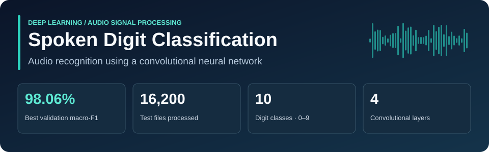
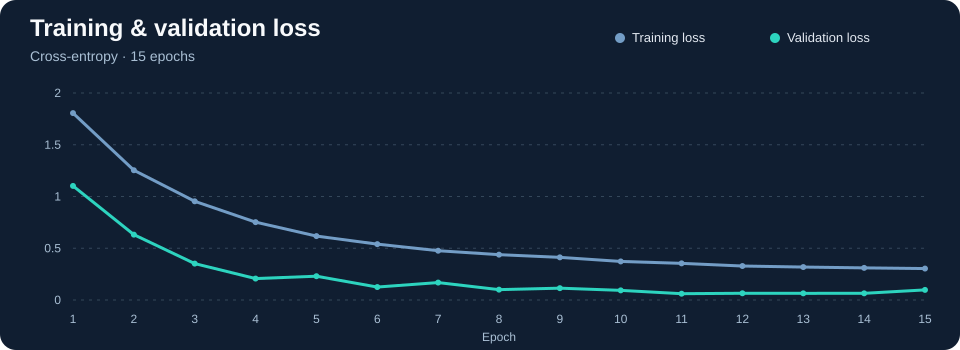
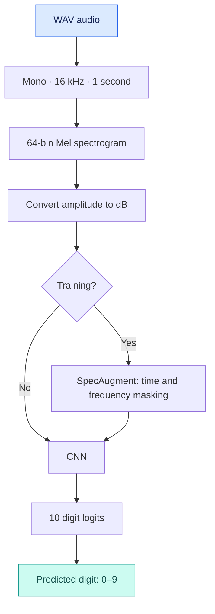
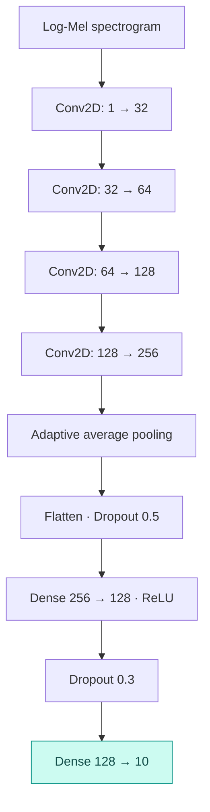

<div align="center">




**Deep Learning · Audio Signal Processing · Speech Recognition**

[Explore notebook](digit-recognition-2.ipynb) · [View presentation](digit_recognition_solution.pptx) · [Quick start](#quick-start)

[Overview](#project-overview) · [Results](#model-performance) · [Workflow](#methodology) · [Architecture](#cnn-architecture)

</div>

---

## Project overview

**Can a convolutional neural network recognize spoken digits directly from audio recordings?**

This project classifies spoken digits (0–9) from WAV audio using a four-layer CNN trained on log-Mel spectrograms. The pipeline combines standardized audio preprocessing, training-only spectrogram augmentation, and best-checkpoint selection using validation macro-F1.

| Technical challenge | Approach |
| :--- | :--- |
| Variable audio length and sample rate | Resampling, mono conversion, padding and truncation |
| Learning time-frequency patterns | 64-bin log-Mel spectrograms and 2D convolutions |
| Overfitting | SpecAugment, batch normalization and dropout |
| Model selection | Stratified validation and best macro-F1 checkpoint |

## Model performance


The best checkpoint achieved **98.06% validation macro-F1 at epoch 11**, an improvement of **37.80 percentage points** over the first epoch. Inference generated predictions for **16,200 test recordings**.

<details>
<summary><b>Expand training and validation loss analysis</b></summary>



| Metric | Recorded result |
| :--- | ---: |
| Best validation macro-F1 | 98.06% |
| Best checkpoint epoch | 11 |
| Validation loss at best checkpoint | 0.0609 |
| Final training loss | 0.3038 |
| Final validation macro-F1 | 96.58% |

The final epoch did not outperform epoch 11, highlighting the value of saving the best checkpoint. These are recorded validation results; independent test scores are not reported.

</details>

## Methodology



### Audio preprocessing & feature engineering

- Load WAV files and resample to 16 kHz.
- Convert multi-channel recordings to mono.
- Pad or truncate to 16,000 samples (one second).
- Extract 64-bin Mel spectrograms and convert to decibels.
- Apply frequency masking (15) and time masking (35) only during training.
- Use a stratified 80/20 training-validation split.

## CNN architecture



Each convolution uses a 3×3 kernel, batch normalization and ReLU. The first three blocks include 2×2 max pooling. Adaptive average pooling produces a fixed-size 256-dimensional representation before the classifier.

## Dataset & training configuration

**Dataset:** EE708 digit recognition competition audio files. The notebook expects labeled training recordings and unlabeled test recordings. The dataset itself is not included in this repository.

| Parameter | Value |
| :--- | :--- |
| Sample rate | 16,000 Hz |
| Audio length | 1 second |
| Mel bins | 64 |
| Target classes | 10 (digits 0–9) |
| Training / validation | 80 / 20, stratified by label |
| Batch size | 32 |
| Epochs | 15 |
| Optimizer | Adam |
| Learning rate | 0.001 |
| Loss | Cross-entropy |
| Checkpoint metric | Macro-F1 |

## Technology stack

| Area | Tools |
| :--- | :--- |
| Programming | Python |
| Deep learning | PyTorch |
| Audio processing | TorchAudio |
| Data manipulation | Pandas, NumPy |
| Evaluation | Scikit-learn |
| Development | Jupyter Notebook, Kaggle |

## Repository structure

```text
Spoken-Digit-Recognition-Audio-CNN-Classifier/
├── README.md
├── digit-recognition-2.ipynb
├── digit_recognition_solution.pptx
└── assets/
    ├── project-overview.svg
    ├── validation-f1.svg
    └── training-loss.svg
```

## Quick start

Clone the repository and open the notebook in Kaggle or Jupyter.

```bash
git clone https://github.com/Shilpeekumari23/Spoken-Digit-Recognition-Audio-CNN-Classifier.git
cd Spoken-Digit-Recognition-Audio-CNN-Classifier
pip install torch torchaudio pandas numpy scikit-learn jupyterlab
jupyter lab digit-recognition-2.ipynb
```

Supply the EE708 digit recognition competition dataset with this structure:

```text
dataset/
├── train.csv
├── train_audio/train_audio/
└── test_audio/test_audio/
```

The original notebook uses Kaggle paths. Adjust BASE_PATH and the checkpoint/submission output paths for local execution. Run all cells to train, select the best checkpoint and generate submission.csv.

## Limitations & future scope

- Validation is stratified by digit, not explicitly grouped by speaker.
- Independent test labels and scores are not reported.
- Future work can evaluate speaker-disjoint performance and robustness to background noise.

---

<div align="center">

[Notebook](digit-recognition-2.ipynb) · [Presentation](digit_recognition_solution.pptx) · [Back to overview](#project-overview)

</div>
