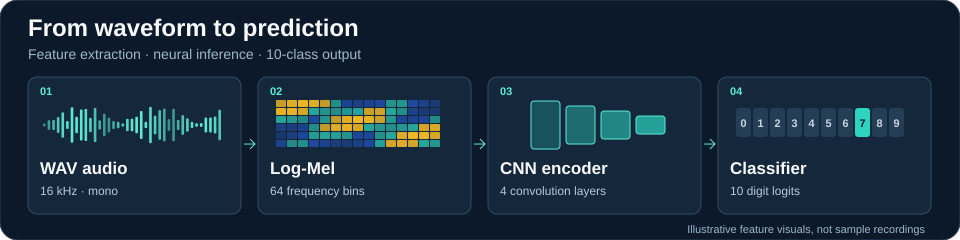
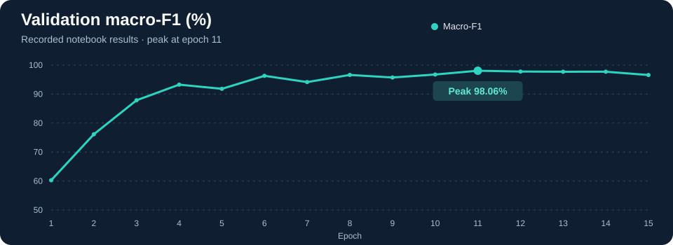
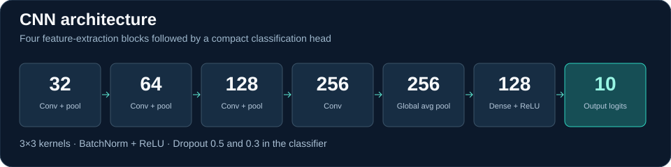

<div align="center">


[**Explore notebook**](digit-recognition-2.ipynb) · [Presentation](digit_recognition_solution.pptx) · [Results](#performance) · [Run locally](#quick-start)

</div>

---

## Project overview

A deep learning system that converts spoken audio into one of ten digit classes (0–9). Instead of classifying raw waveforms, the model learns time-frequency patterns from log-Mel spectrograms using a four-layer CNN.



| Challenge | Design choice |
| :--- | :--- |
| Variable recording length and sampling rate | Standardize audio to mono, 16 kHz and one second |
| Learning speech features | 64-bin log-Mel spectrograms |
| Overfitting | Training-only SpecAugment, batch normalization and dropout |
| Reliable checkpoint selection | Stratified validation and macro-F1 |

## Performance



| Best validation macro-F1 | Best epoch | Validation loss | Test recordings processed |
| :---: | :---: | :---: | :---: |
| **98.06%** | **11 / 15** | **0.0609** | **16,200** |

The best checkpoint improved macro-F1 by **37.80 percentage points** from the first epoch and was used for test inference. Independent test scores are not reported.

<details>
<summary><b>Explore training and validation loss</b></summary>


The final training loss was 0.3038, while final validation macro-F1 was 96.58%. Selecting the epoch-11 checkpoint preserves the highest recorded validation score.

</details>

## How it works

**01 — Audio preparation:** Load WAV recordings, resample to 16 kHz, convert to mono and pad or truncate to one second.

**02 — Feature extraction:** Transform the waveform into a 64-bin Mel spectrogram and convert its amplitude to decibels.

**03 — Data augmentation:** Apply frequency masking (15) and time masking (35) during training only.

**04 — Classification:** Learn time-frequency features with a convolutional encoder and predict the digit from ten output logits.

## CNN architecture



The first three convolutional blocks use max pooling. Each convolution uses a 3×3 kernel, batch normalization and ReLU. Adaptive average pooling compresses the final feature maps into a 256-dimensional representation.

<details>
<summary><b>Expand model training configuration</b></summary>

| Parameter | Value |
| :--- | :--- |
| Training / validation split | 80 / 20, stratified by digit |
| Batch size | 32 |
| Epochs | 15 |
| Optimizer | Adam |
| Learning rate | 0.001 |
| Loss function | Cross-entropy |
| Checkpoint metric | Macro-F1 |
| Classifier dropout | 0.5 and 0.3 |

</details>

## Quick start

```bash
git clone https://github.com/Shilpeekumari23/Spoken-Digit-Recognition-Audio-CNN-Classifier.git
cd Spoken-Digit-Recognition-Audio-CNN-Classifier
pip install torch torchaudio pandas numpy scikit-learn jupyterlab
jupyter lab digit-recognition-2.ipynb
```

<details>
<summary><b>Dataset setup and repository structure</b></summary>

The notebook uses the EE708 digit recognition competition dataset, which is not included in this repository.

```text
dataset/
├── train.csv
├── train_audio/train_audio/
└── test_audio/test_audio/
```

Update BASE_PATH and the Kaggle checkpoint/submission output paths for local execution. Run all cells to train the model, load the best checkpoint and generate submission.csv.

```text
├── README.md
├── digit-recognition-2.ipynb
├── digit_recognition_solution.pptx
└── assets/
    ├── project-overview.svg
    ├── audio-pipeline.svg
    ├── cnn-architecture.svg
    ├── validation-f1.svg
    └── training-loss.svg
```

</details>

## Limitations & future scope

Validation is stratified by digit, not explicitly grouped by speaker. Independent test labels and scores are not reported. Speaker-disjoint evaluation and testing under background noise would help establish robustness.

---

<div align="center">

[Notebook](digit-recognition-2.ipynb) · [Presentation](digit_recognition_solution.pptx) · [Back to overview](#project-overview)

</div>
